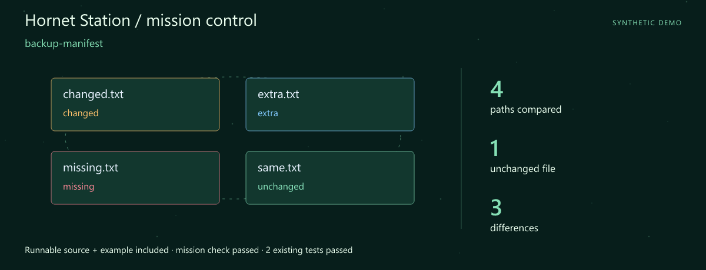
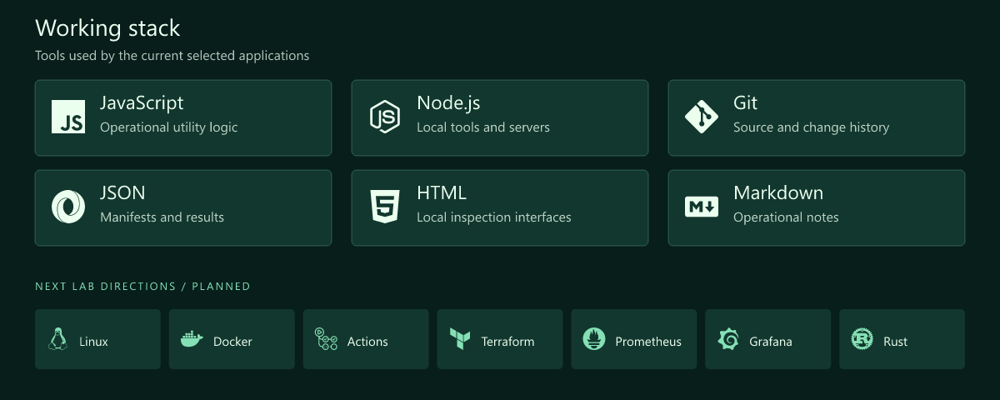
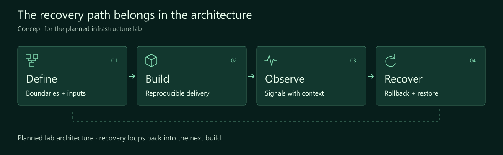
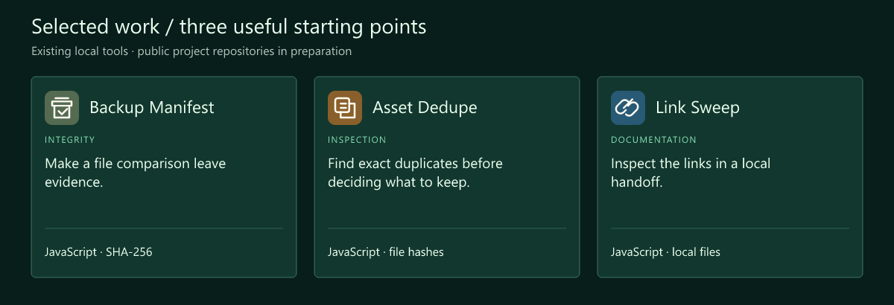

# Lü Shu · DevOps Engineer · Systems Architecture

> **Hornet Station** · Every system needs a way home.

**Build the system. Understand the signals. Design the recovery.**

[Download the runnable mission](src/assets/launch.zip) · [Launch guide](src/LAUNCH.md) · [Working stack](#working-stack) · [Selected work](#selected-work)

## Mission control



**First launch: backup-manifest.** A complete source snapshot, synthetic example and assertion script are included. The mission check and **2 existing tests** passed. [Try the mission](src/LAUNCH.md) · [Snapshot and checked result](src/assets/launch.json).

I'm Lü Shu. My focus is DevOps and systems architecture. This workspace connects practical operational tools with a planned infrastructure lab: reproducible delivery, observable behaviour and a recovery procedure someone else can follow.

I want the architecture diagram, the deployment notes and the restore procedure to tell the same story. The first building blocks here are deliberately inspectable: hashes, manifests and local documentation checks.

## What I focus on

- **Architecture with boundaries.** Make inputs, responsibilities and failure paths visible before a deployment.
- **Operational evidence.** A manifest, a useful signal or a documented check should support the next decision.
- **Recovery as part of the design.** Plan the rollback and restore alongside the build, then exercise them in a lab.

## Working stack



The upper panel shows technologies used by the selected tools. The lower row is the next lab track.

## How I think about the work



## Selected work

Three existing local tools form this curated collection. Their public project repositories are being prepared.



| Project / stack | Why it belongs here | Input → output |
| --- | --- | --- |
| **Backup Manifest**<br>JavaScript · SHA-256 | Make a file comparison leave evidence. Create SHA-256 manifests and compare a set of files with an expected manifest. | **In:** Files + optional manifest<br>**Out:** Hashes and comparison findings |
| **Asset Dedupe**<br>JavaScript · file hashes | Find exact duplicates before deciding what to keep. Hash selected assets and list exact duplicates for a separate review decision. | **In:** Selected files<br>**Out:** Exact-duplicate groups |
| **Link Sweep**<br>JavaScript · local files | Inspect the links in a local handoff. Check internal references in a local documentation export. | **In:** Local export files<br>**Out:** Internal-link findings |

### The first lab, drawn before it is deployed

```text
versioned inputs → build → deploy → observe
                       ↑              │
                       └── recover ───┘
```

A design sketch for the planned lab. Backup Manifest supplies file-integrity evidence; a complete restore procedure will also need configuration, storage and an exercised recovery path.

## Code and activity


These charts are rebuilt on a six-hour schedule after GitHub Pages is enabled. The observation time is printed on every chart. Commits are unique default-branch SHAs across all authors and owned public repositories, including forks. Language bytes describe repositories, not personal skill. Public interactions are a limited event feed (up to 300 events / 30 days), not visitor analytics. API and image caches may delay updates.

[Live data and scope](https://brolushu.github.io/BroLuShu/src/assets/live/metrics.json) · [Portfolio website](https://brolushu.github.io/BroLuShu/) · [Refresh setup](src/SETUP.md)

## Next lab

1. **A repeatable deployment.** Document one Linux/container lab with explicit configuration inputs.
2. **A useful observation loop.** Explore Prometheus and Grafana around a small service.
3. **An exercised recovery.** Record rollback and restore steps, expected results and the evidence.

## Start a conversation

A recovery scenario, an unclear boundary or an operational check that needs a better explanation is a useful topic for the architecture notebook.

[Open the profile repository's issues](https://github.com/BroLuShu/BroLuShu/issues) · [Browse the repositories](https://github.com/BroLuShu?tab=repositories)

> 🛠️ Designing systems that can recover.

---

<sub>Fictional developer persona · AI-illustrated avatar. Curated tools retain original authors, licenses and commit history. Technology icons: Simple Icons.</sub>

[Artwork and data notes](src/assets/NOTICE.md)
